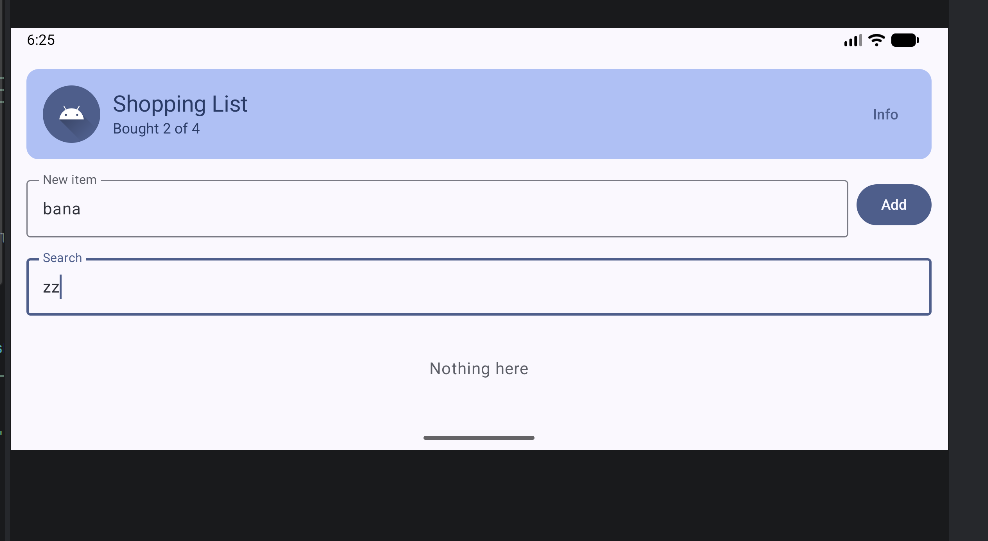
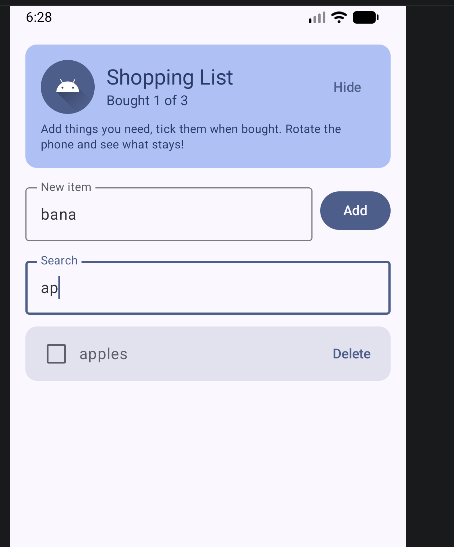
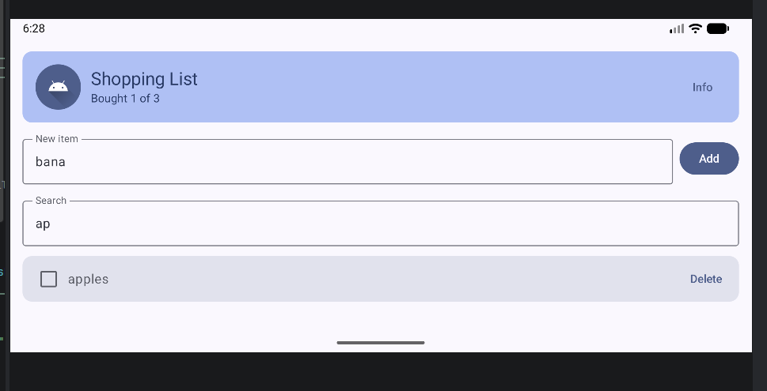

# JustShoppingList

A simple shopping list app for Android, made with Kotlin, Jetpack Compose (Material 3) and ViewModel.
You add things you need to buy, tick them when bought, delete them and search in the list.

## Features

- **Add items:** type a name and press Add
- **Mark as bought:** tick the checkbox and the item gets crossed out. The counter "Bought X of Y" updates right away
- **Delete items** with the Delete button
- **Search:** the list filters while you type, and if nothing matches it shows "Nothing here"
- **Info button** shows a small tip

## How state works

| State | Kept in | After rotation |
|---|---|---|
| Shopping list, search text | `ShoppingViewModel` | stays |
| New item text (not added yet) | `rememberSaveable` | stays |
| Info tip open/closed | `remember` | resets |

- `remember` keeps a value only while the Activity is alive, so rotation resets it
- `rememberSaveable` also saves the value in a Bundle, so it survives rotation
- `ViewModel` lives outside the UI and survives rotation. It keeps the list and the logic

The UI is in `ShoppingScreen.kt`, and the state and logic are in `ShoppingViewModel.kt`.
Reusable composables: `HeaderCard`, `AddItemRow`, `ShoppingItemCard`, `EmptyState`.

## How to run

1. Clone the repo, or download it as ZIP
2. Open the folder in Android Studio (File → Open)
3. Wait for the Gradle sync to finish
4. Start an emulator or connect a phone with USB debugging on
5. Press **Run ▶**

## Screenshots

| Main screen | Search, nothing found |
|---|---|
|  |  |

**Rotation demo.** Before: Info is open, there is a draft "bana" and the search is "ap". After rotating, the list, the search and the draft stay, but the Info tip closes.

| Before rotation | After rotation |
|---|---|
|  |  |
